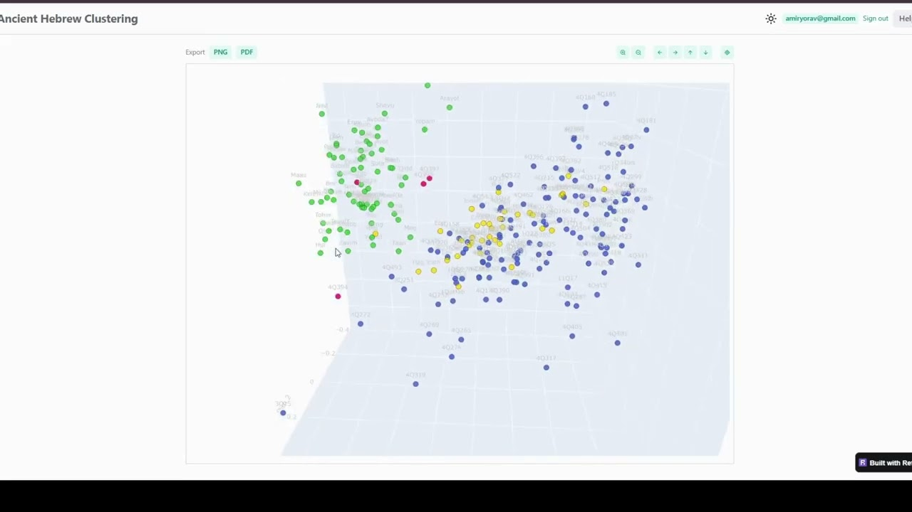

# Ancient Hebrew Clustering

An interactive workspace for Hebrew stylometry. It compares how Biblical (Mikra), Mishnaic, and Dead Sea Scrolls texts use words and grammar.

Pick books, choose lemma or morphology features, build a book × signature matrix, reduce and cluster it, then inspect which features distinguish one group from another. Guests can run the full analysis without signing in. Google sign-in is optional and is used to save presets and hand-picked book groups.

Live site: https://dss-clustering.reflex.run

## Quick guide

[](https://www.youtube.com/watch?v=xeCl2L_JISw)

A longer walkthrough of the page and the analysis is in [APP_OVERVIEW.md](APP_OVERVIEW.md).

## Run locally

Requires Python 3.12.

```powershell
python -m venv .venv
.venv\Scripts\python.exe -m pip install -r requirements.txt
copy .env.example .env
```

Fill in `.env` from `.env.example`. `DATABASE_URL` must point at the Postgres database that holds the corpus. Google sign-in also needs `GOOGLE_CLIENT_ID`.

```powershell
.venv\Scripts\reflex.exe run --env prod --single-port
```

The app is then at http://localhost:3000/. Production mode does not hot-reload; stop the process and start it again after code changes.

## Tests

```powershell
.venv\Scripts\python.exe -m pytest
```
